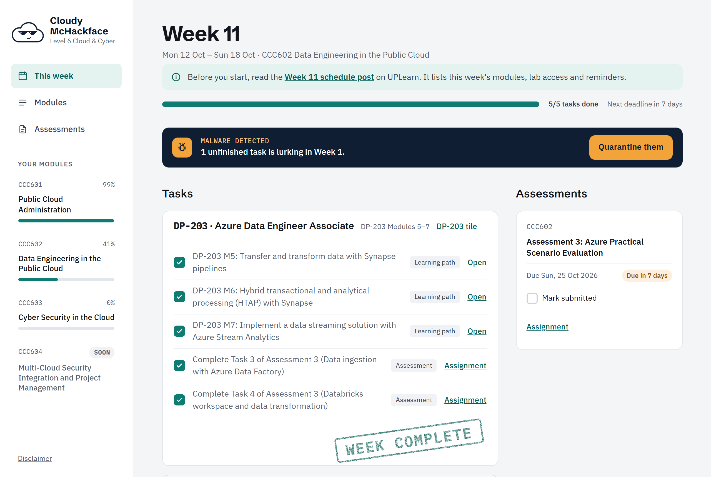
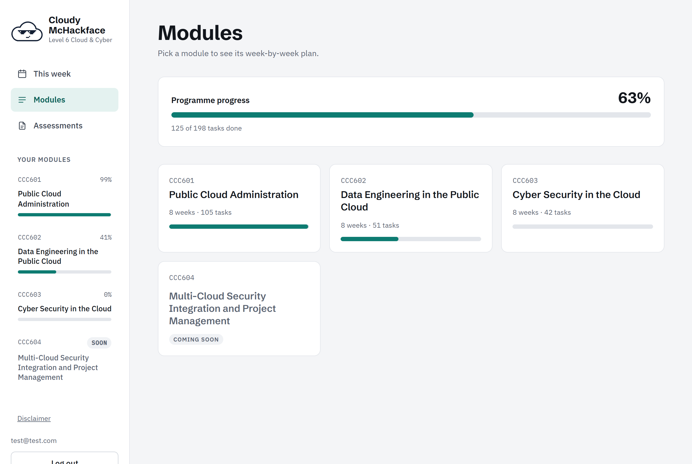
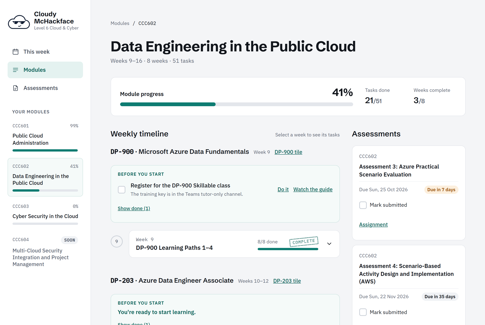
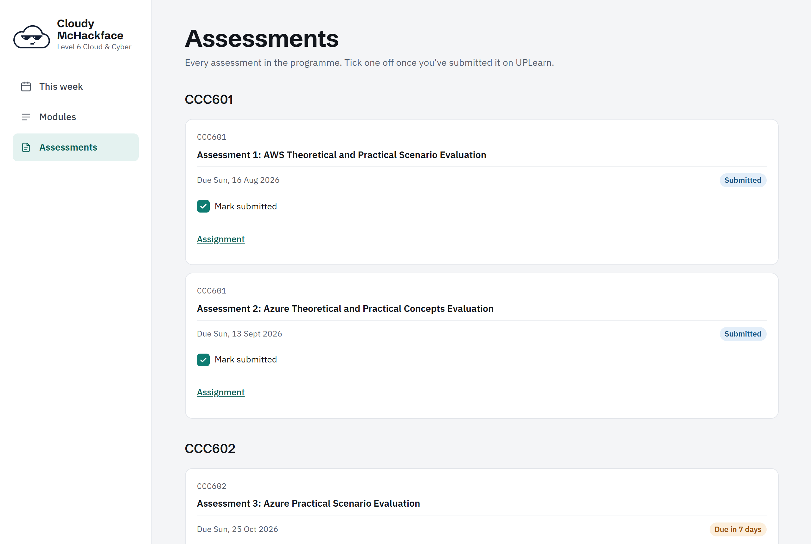

<p align="center">
  
</p>

<h1 align="center">Cloudy McHackface</h1>

<p align="center">
  A study tracker for the Yoobee Colleges <strong>Diploma in Cloud Computing and Cyber Security (Level 6)</strong>.<br>
  What to do this week, what's due next, and how far through you are.
</p>

<p align="center">
  <a href="https://cloudy-mchackface.fly.dev"><strong>Try it live →</strong></a>
</p>

> [!IMPORTANT]
> **This isn't an official Yoobee app.** A student built it. Yoobee Colleges didn't make, endorse or approve it. UPLearn is always the source of truth for dates, weeks and assessment details, so check there and with your tutors.



## Why it exists

I'm studying this diploma full-time, and the UPLearn portal kept getting in the way. Every week meant digging through course tiles, forum posts and assignment pages just to work out what I was meant to be doing. Once I'd done something, there was nowhere to tick it off, so I never had a clear picture of where I was up to.

So I built the thing I wanted: one screen that tells me what this week is about, links straight to the work, and keeps score. If I had these problems, other students on the course probably do too.

## What it does

- **This week, worked out for you.** It knows your intake's week dates and today's date in NZ time, so it opens on the right week with no setup. It also handles breaks and public holidays.
- **One checklist per week.** Microsoft Learn paths, AWS Academy modules, Skillable labs and assessment tasks are all in one list, each with a link to where the work happens and back to the right UPLearn page.
- **Progress bars** for each course and for the whole programme, based on what you've ticked.
- **Deadlines.** Every assessment with its due date, a countdown, and a "submitted" tick.
- **Catch-up help.** Leftover tasks from earlier weeks show up as "malware" you can quarantine. Finished weeks get a stamp.
- **Works on your phone**, so you can tick things off from the couch.

| Modules | Module timeline |
| --- | --- |
|  |  |



## Have a look around

Open **[cloudy-mchackface.fly.dev](https://cloudy-mchackface.fly.dev)** and log in with the demo account:

| Email | Password |
| --- | --- |
| `test@test.com` | `1234567890` |

Everyone shares the demo account, so expect other people's ticks. If you're on the course, sign up with your own email instead. New accounts get past weeks pre-ticked, so you start from where you are.

### What's covered

| Course | Status |
| --- | --- |
| CCC601 Public Cloud Administration | ✅ Full schedule |
| CCC602 Data Engineering in the Public Cloud | ✅ Full schedule |
| CCC603 Cyber Security in the Cloud | ✅ Full schedule |
| CCC604 Multi-Cloud Security Integration and Project Management | 🔜 Added once the course opens |

Only the full-time schedule (July 2026 intake) for now. Part-time will follow once the dates are confirmed.

## Playing fair with Yoobee

- **It never does the work for you.** There's no AI writing answers, and assessments aren't stored or shared. It points you to the assessment on UPLearn and lets you tick it off.
- **It doesn't copy Yoobee's content.** It holds the schedule structure, titles, due dates and public links (Microsoft Learn, AWS) and links back to UPLearn for everything else. No briefs, rubrics or tutor posts.
- **It doesn't need your UPLearn login.** It stores your email and the tasks you've ticked, and doesn't scrape the portal. It never shows lab training keys or tutor contact links.

Spotted a wrong date or a missing task? [Open an issue](../../issues) or email joeldevwood@gmail.com.

## Running it locally

**Stack:** React + Vite + TypeScript (TanStack Query) on the front, FastAPI + SQLAlchemy + Alembic on the back, Postgres (Neon) for data, deployed to Fly.io as a single container.

```
backend/    FastAPI app, Alembic migrations, pytest
frontend/   React + Vite app (proxies /api to the backend in dev)
seed/       YAML course content, one file per module, plus the intake schedule
docs/       Design specs
```

You'll need Python 3.12+ with [uv](https://docs.astral.sh/uv/), Node 20+, and a Postgres database.

1. Copy `backend/.env.example` to `backend/.env` and fill in `DATABASE_URL` and `TEST_DATABASE_URL`. Use a separate database for tests, because they wipe it.
2. Start the backend:
   ```bash
   cd backend
   uv sync
   uv run alembic upgrade head
   uv run python -m app.seed          # loads seed/*.yaml
   uv run uvicorn app.main:app --reload
   ```
3. In another terminal, start the frontend:
   ```bash
   cd frontend
   npm install
   npm run dev                        # http://localhost:5173
   ```

Tests and checks:

```bash
cd backend && uv run pytest
cd frontend && npm run lint && npm test && npm run build
```

### Course content

All course content lives in `seed/` as YAML, structured as **Module → certification track → Week → Task**. Every item has a stable `key`, and the loader upserts by key, so fixing a typo or adding a task doesn't wipe anyone's ticks. `seed/schedule.yaml` holds each intake's week start dates and public holidays.

## Contributing

Issues and pull requests are welcome, especially schedule fixes from other students. Work goes on the `dev` branch, and `main` is what's live.

## Licence

[MIT](LICENSE). Use it, fork it, adapt it for your own course.
